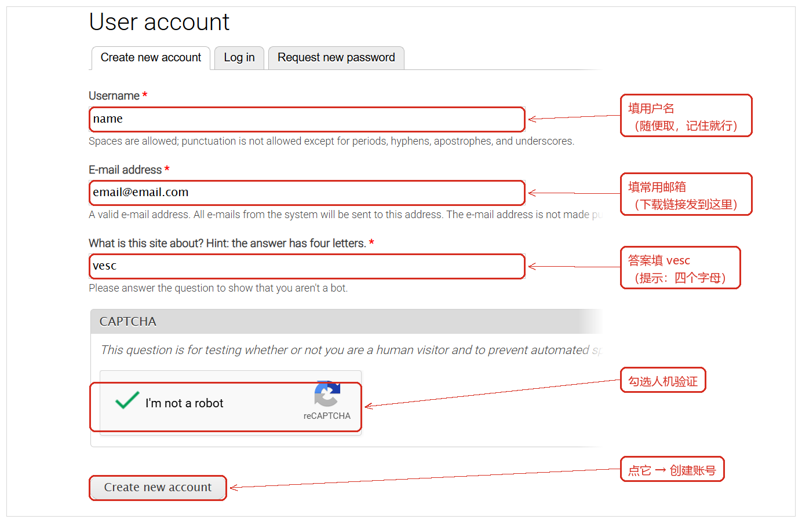
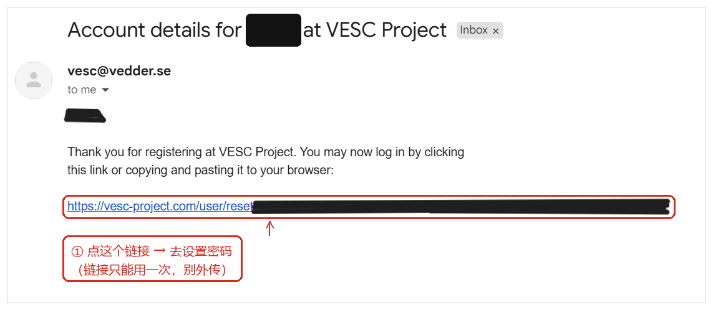
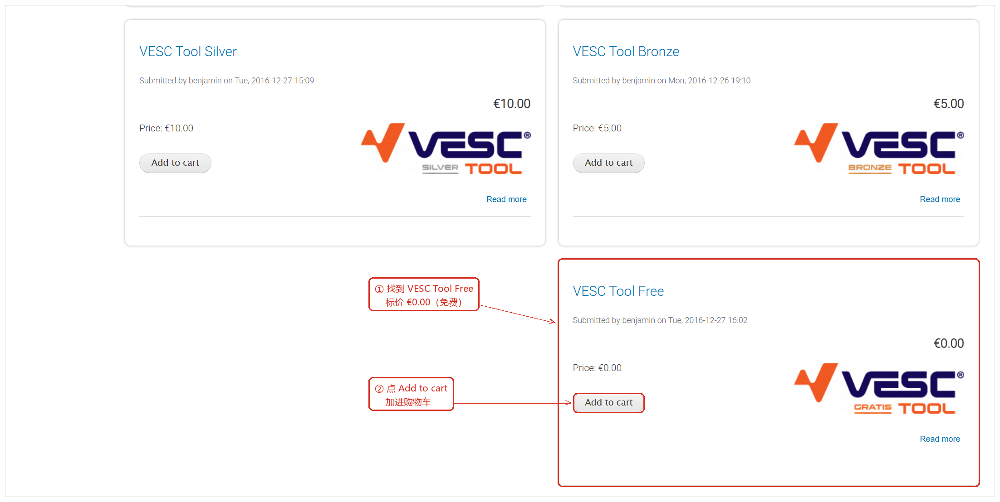
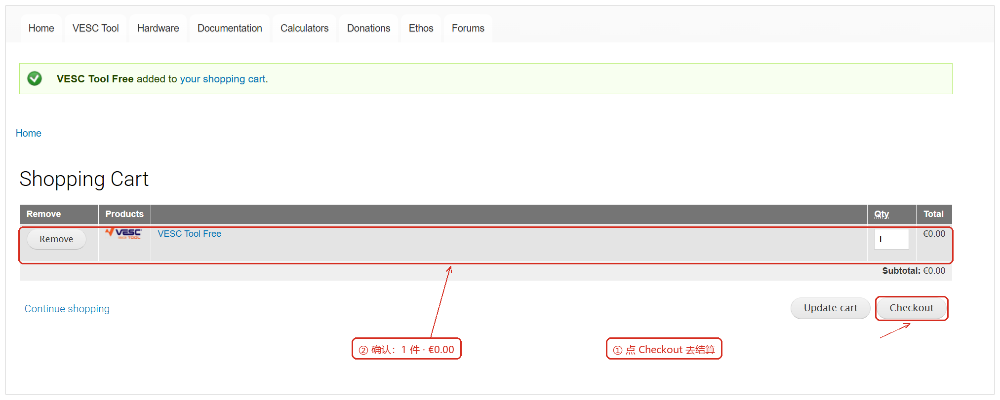
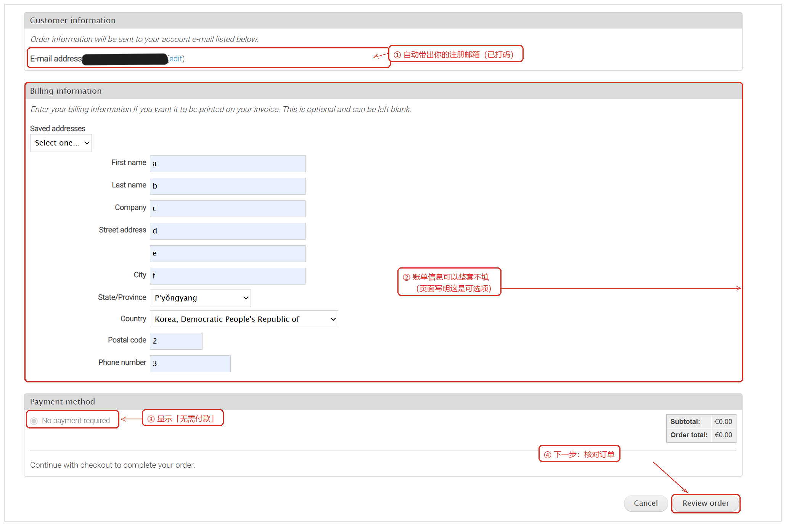
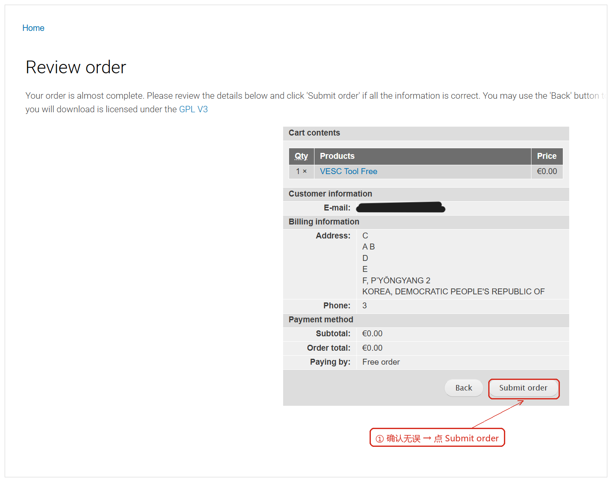
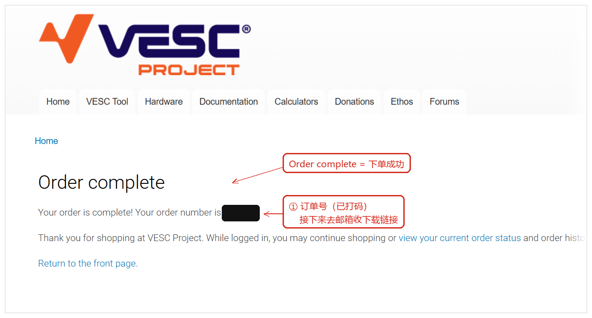
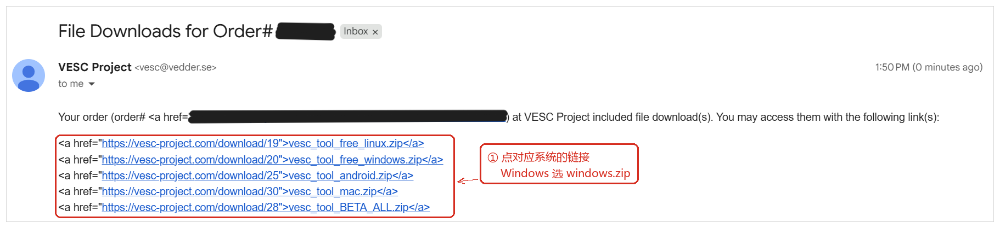

# 官网免费下载最新 VESC Tool 指南

## 0. 简述

整个流程拆成两个阶段、八小步：

| 阶段 | 步骤 | 你要做的事 | 做完的标志 |
| --- | --- | --- | --- |
| 一、注册账号（只做一次） | ① 填注册表 | 用户名 + 邮箱 + 验证码 | 页面提示账号已创建 |
| | ② 邮箱设密码 | 打开邮件里的重置链接设置密码 | 能登录官网 |
| 二、0 元下单换下载链接 | ③ 加购物车 | 在 VESC Tool 页面点 Free 卡片的 Add to cart | 顶部出现 `1 Item` |
| | ④ 去结算 | 购物车点 Checkout | 进入 Checkout 页面 |
| | ⑤ 填信息 | 账单信息可整套留空，点 Review order | 进入 Review order 页面 |
| | ⑥ 核对并提交 | 点 Submit order | 跳到 Order complete |
| | ⑦ 下单成功 | 记住订单号（可留可不留） | 订单即时生效，不用付款 |
| | ⑧ 收邮件下载 | 点邮件里蓝色链接 | 拿到 5 个下载链接 |

**开工前准备：**

- 一个能正常收信的邮箱；
- 一个浏览器（Chrome / Edge / Firefox / Safari）
- 大约 10 分钟；
- 知道自己是 Windows、macOS、Linux 还是 Android...

---

## 1. 第一阶段：注册账号

### 步骤 1｜打开注册页，填三个空

打开官网 <https://vesc-project.com/>，找到 **User account** 入口（进去后页面左上角会显示 `Home » User account` ），切到 **Create new account** 标签。

按图上的 ①～⑤ 依次填：

| 序号 | 字段 | 怎么填 |
| --- | --- | --- |
| ① | **Username** | 用户名，随便取一个自己记得住的。**可以有空格**，但除了句点、连字符、撇号、下划线之外不能有其他标点。 |
| ② | **E-mail address** | **填你每天都在用的邮箱**。官网所有邮件（设密码链接、下载链接）都发到这里，而且这个邮箱不会公开显示。 |
| ③ | **What is this site about?** | 题目提示「答案有四个字母」，正确答案就是 **`vesc`**。 |
| ④ | **CAPTCHA** | 勾选 **I'm not a robot**。如果弹出图片验证，按提示点选即可。 |
| ⑤ | **Create new account** | 点这个按钮提交。 |

### 步骤 2｜去邮箱点链接，设置密码

提交后很快就会收到一封官网邮件，发件人是 **VESC Project `<vesc@vedder.se>`**，标题形如 `Account details for 你的用户名 at VESC Project`。

打开这封邮件，点里面那条 `https://vesc-project.com/user/reset/...` 的蓝色链接，按提示设置新密码。

> 这封邮件里的链接**只能用一次**，而且有时效，**不要转发给别人**，收到后尽快设置密码。
> 没收到的话：先翻**垃圾邮件 / 推广**文件夹；还是没有，考虑用登录页的 **Request new password** 重新发一次。

设置好密码后回到官网，用 **Log in** 输入用户名（或邮箱）+ 密码登录。**到这里，账户注册就完事了**。

---

## 2. 第二阶段：0 元下单，换下载链接

### 步骤 3｜把 VESC Tool Free 加入购物车

登录后点顶部导航的 **VESC Tool**，页面会列出几个版本：拉到最底下可以看到0元选项

>看起来这些版本内容似乎完全相同，如果你愿意为vesc捐款的话也可以选择付费的，唯一的区别是你会获得软件徽章和网站logo？(

点 Free 那张卡片里的 **Add to cart**，页面顶部购物车会变成 `1 Item / Total: €0.00`。

### 步骤 4｜购物车 → Checkout

点确认条里的 `your shopping cart`，或者右上角的 **View cart**，进入购物车页：

核对：**商品是 VESC Tool Free**、**数量 1 件、合计 €0.00**。而后点右下角的 **Checkout**。

### 步骤 5｜Checkout 页面填信息

需要填写结算页信息：

| 区块 | 内容 | 怎么处理 |
| --- | --- | --- |
| ① **Customer information** | 自动带出你的注册邮箱 | 一般不用动。**如果这里改了邮箱，下载链接就会发到新邮箱**。旁边的 `(edit)` 可以进账号里改。 |
| ② **Billing information** | 名、姓、公司、街道、城市、省/州、国家、邮编、电话 | **整套可以留空**,也可以填写你喜欢的个人信息 |
| ③ **Payment method** | 显示 **No payment required**（无需付款） | 如果加入购物车的是免费版本则不需要选 |
| ④ **Review order** | 右下角按钮 | 点它进入核对页。 |

### 步骤 6｜核对信息，提交订单

到了 Review order 页，进行简单确认：

核对清单：

- [x] **Cart contents**：`1 × VESC Tool Free`，价格 `€0.00`
- [x] **Customer information**：你的个人邮箱
- [x] **Payment method**：`Paying by: Free order`（免费单），`Order total: €0.00`
- [x] 页面提到软件以 **GPL V3** 协议发布

都对就点 **Submit order**。想改前面的信息就点 **Back**

### 步骤 7｜看到 Order complete

`Submit order` 之后会跳到这一页，标题是 **Order complete**：

页面会给你一个订单号（图里已打码）。**这个号记不记都行**：以后要回来看订单，登录后点页面里的 `view your current order status and order history` 就能找到当前订单和下载入口。

### 步骤 8｜在邮箱收下载链接，下载压缩包

通常几分钟内就会收到第二封邮件：

- 发件人：**VESC Project `<vesc@vedder.se>`**
- 标题：`File Downloads for Order# ...`

这封邮件显示的是**原始 HTML 源码**（`<a href="...">文件名</a>` 这种），**这是官网邮件本来的样子，不是病毒也不是乱码**。你只需要点你需要的链接，浏览器就会开始下载：

| 邮件里的文件名 | 对应系统 |
| --- | --- |
| `vesc_tool_free_windows.zip` | **Windows**（绝大多数人下这个） |
| `vesc_tool_free_linux.zip` | Linux（x86_64） |
| `vesc_tool_mac.zip` | macOS |
| `vesc_tool_android.zip` | Android 手机 / 平板 |
| `vesc_tool_BETA_ALL.zip` | 全平台测试版 |

> 邮件里的每条下载链接可能**跟你的订单绑定**，最好别公开转发。

---

## 3. 下完怎么用

| 系统 | 操作 |
| --- | --- |
| **Windows** | 右键压缩包 → 全部解压 → 双击 `vesc_tool.exe`。如果弹出「Windows 已保护你的电脑」，点 **更多信息 → 仍要运行**。 |
| **macOS** | 解压后打开 `VESC Tool.app`。首次被拦截时去 **系统设置 → 隐私与安全性 → 仍要打开**。 |
| **Linux** | 解压后进入目录，终端执行 `chmod +x vesc_tool` 再 `./vesc_tool`。连不上控制器时，把当前用户加入 `dialout` 组。 |
| **Android** | 安装 APK，系统提示时允许「安装未知来源应用」。 |

---

## 4. 常见问题（FAQ）

**Q1：注册邮件一直没来？**

考虑查垃圾邮件、广告邮件、订阅邮件文件夹；把发件人 `vesc@vedder.se` 加白名单；等 5～10 分钟。仍没有则考虑 **Request new password** 重发，或换一个邮箱注册。

**Q2：€0.00 为什么还要走下单流程？**

官网把免费版也做成了「商品」，只有下单后系统才会生成**属于你的下载链接**并邮件发送。所以流程像购买，但 `Payment method` 显示 **No payment required**，`Paying by: Free order`，不需要付款或者添加支付途径。

**Q3：账单信息必须填真实地址吗？**

不必须。页面明写可选、可留空；填了也只用于打印发票。可以不填或随便填，真填了也不影响下载。

**Q4：订单提交完没收到下载邮件？**

等 5～10 分钟并检查垃圾箱；还不行就登录官网 → **User account** → 订单历史，从当前订单进下载页。邮箱写错了的话，用 `(edit)` 改邮箱或重新下一单。

**Q5：下载链接能给别人用吗？**

不建议公开转发，链接可能和账号、订单绑定。

**Q6：以后出新版本怎么更新？**

重新走一遍第二阶段（③→⑧）下一单即可

**Q7：Silver（€10）/ Bronze（€5）...这些付费版本和 Free 有什么区别？**

按社区信息，Silver、Bronze等**付费版本**和**Free**似乎没有功能上的区别

**Q8：你看到的官网长得不一样？**

截图抓取时官网是这套排版，页面结构以后可能会小改，但**入口命名应当类似**：User account、Add to cart、Checkout、Review order、Submit order、Order complete。找不到时按页面上的这些英文词搜就行。

**Q9：页面全英文看不懂？**

可以考虑使用浏览器自带的翻译（右键 → 翻译成中文）。注意翻译后**按钮文字也会变**

---

## 5. 英文界面速查

| 页面上的英文 | 中文意思 |
| --- | --- |
| User account | 用户账号（登录/注册入口） |
| Create new account | 创建新账号 |
| Request new password | 申请重置密码 |
| Add to cart | 加入购物车 |
| View cart / Shopping Cart | 查看购物车 / 购物车 |
| Checkout | 去结算 |
| Billing information | 账单信息（可留空） |
| No payment required | 无需付款 |
| Review order | 核对订单 |
| Submit order | 提交订单 |
| Order complete | 下单完成 |
| Paying by: Free order | 付款方式：免费订单 |
| File Downloads | 文件下载 |

---
